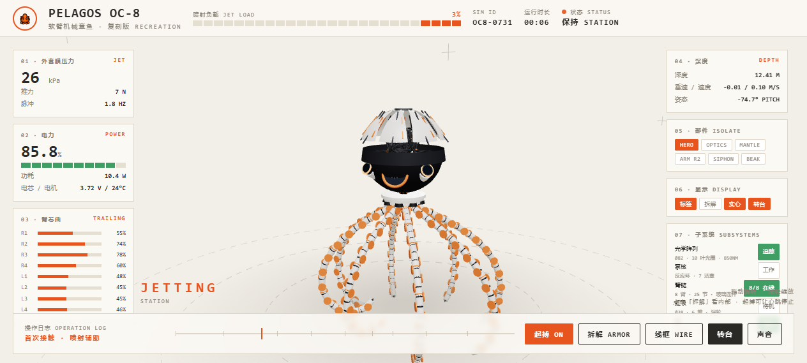

# Claude · 机械章鱼 OC-8

浅色影棚中的 Pelagos OC-8：8 片花瓣式壳甲、缆线脑核、8 条 25 节卷曲腕足、心跳驱动律动、整机拆解与线框。纯 three.js 程序化几何，无外部模型文件，下载后可离线运行。

模型为 **Claude**（Anthropic），具体型号未归档。执行工具为 **WorkBuddy**。目录与版本 ID `workbuddy` 是已发布路径上的工具名，查询别名 `claude` 指向同一版本。

[](index.html)

## 打开成果

| 成果 | 说明 |
|---|---|
| 互动页 | [index.html](index.html)。拖动旋转，滚轮缩放。「拆解」在常态与整机拆解之间切换，「线框」在实心与线框之间切换。起搏、转台、声音是附加控制。 |
| 自动巡览 | [film.html](film.html)。25 秒一轮：环绕、拆解、线框、特写、重组。下载后双击可离线播放。 |
| 在线 | [互动](https://topmindspace.github.io/awesome-ai-recreations/cases/oc8/models/workbuddy/index.html) · [巡览](https://topmindspace.github.io/awesome-ai-recreations/cases/oc8/models/workbuddy/film.html) |
| 静帧 | [stills/](stills/)：常态、侧视、拆解、线框，共 9 张贡献时截图 |

## 重建

工作目录：`cases/oc8/models/workbuddy`。浏览器打开上面两个 HTML 即可；重建巡览页需要 Node.js 18+。

依赖只有随库提交的 [lib/three.min.js](lib/three.min.js)（three.js r148 UMD），没有 npm 安装步骤。实现在 [src/main.js](src/main.js)，规格与改编项在 [src/spec.md](src/spec.md)。

从**本目录**执行：

```bash
node src/build.mjs   # 用 index.html 与巡览驱动覆盖生成 film.html
node src/check.mjs   # 检查交付文件存在，以及页面引用了 three.js 与 main.js
```

`build` 的输出应与已提交的 `film.html` 字节一致。

## 输入与执行

- 任务 ID：`oc8`。输入版本：`input_version: 3`。
- 参考输入：任务书冻结的九张原作关键帧（`cases/oc8/task/references/`）。贡献记录写明未使用任务包外参考。
- `input_sha256`：原会话没有归档当时的计算值。当前仓库冻结的 v3 共同输入，由 `python3 scripts/catalog.py recreate oc8` 得到 `e549680a8829bb385d3841d287172021a13b10c959a337f01b2aa35f5828359e`，与 [cases/inputs.lock.json](../../../../cases/inputs.lock.json) 中的 `oc8` 一致。这是现在这份输入的摘要，不是原会话另行保存的摘要。
- **模型**：Claude（Anthropic）。具体型号未归档，这里不补写 Opus、Sonnet 或其他型号。
- **执行工具**：WorkBuddy。贡献记录里的会话智能体署名为「小柏」，验收人为「小白」。执行条件是交互式对话，记录写约 15 轮截图迭代。
- 人工介入：记录写明没有引入外部素材；配色、材质与 HUD 版式为执行者重诠释。
- `visual_goal: fidelity`（整体按原作帧复刻；HUD 与部分结构为重诠释）。`provenance: independent`（记录写明未复用已有实现）。

## 验收与限制

贡献记录中的检查：

- 常态、拆解、线框截图见 [stills/](stills/)，并写明当时浏览器控制台无 JS 报错。
- 8 条腕足按 1/8 周期相位差卷曲；花瓣壳用铰点在环圈上的郁金香铰链；拆解是按部位延迟位移，不是随机爆散。
- 终版做过 `node --check`。本版没有接入 `shared/` 的机器可读 QA。

2026-11-14 复核见 [实现与验证](records/实现与验证.md)：本地 http 与 `file://` 都能打开两个页面，三态可切换，巡览会进入拆解和线框，`node src/build.mjs` 可重复生成与提交一致的 `film.html`。

已知差距：

- 颚部开合、虹吸喷进等原作动作没有逐一对照原作时刻复现。
- 原作约 25 秒的切镜编排没有逐镜复现；巡览页是环绕加三态切换。
- 帧间不可见的内部结构由执行者推断，没有归档估算尺寸明细。

## 来源与许可

- 原作：[@0x_fokki 的 Pelagos OC-8 演示](https://x.com/0x_fokki/status/2116289885870981296)。按任务书以关键帧为可见证据复刻。
- 依赖：three.js（MIT License）。
- 本版由 WorkBuddy 会话产出，随仓库许可分发。关联：[任务书](../../task/brief.md) · [系列索引](../../../../series/机械复刻系列/README.md) · [NOTICE](../../../../NOTICE.md)。
